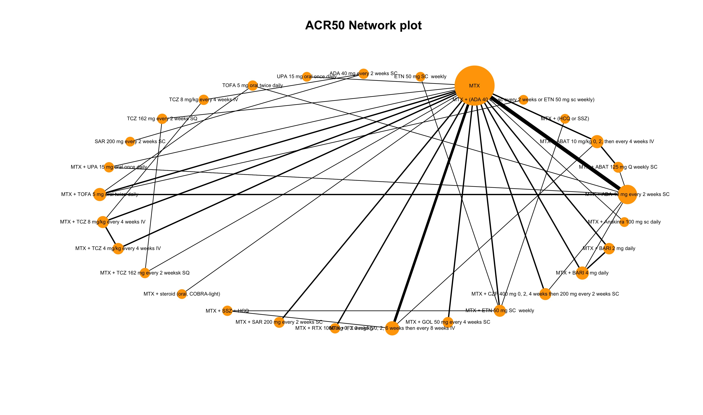

---
title: "Rheumatoid Arthritis"
description: "Systematic review and network meta-analysis of pharmacological interventions for rheumatoid arthritis"
date: "2026-11-25"
categories:
  - Rheumatology
  - Network Meta-analysis
  - GRADE
toc: true
---

## Overview

This research collection presents evidence from systematic
reviews and network meta-analyses evaluating pharmacological
interventions for rheumatoid arthritis.

## Study characteristics

Study characteristics will be presented here.

## Network meta-analysis results

Comparative treatment effects will be presented here.

## Summary of findings

GRADE certainty of evidence assessments and summary of
findings tables will be presented here.

## Figures

Network plots, forest plots and league tables will be
presented here.
## Network plot

## Research data

Downloadable research datasets will be available here.
## Download research results

| Resource | Download |
|---|---|
| NMA results | [Download EXCEL](results/outcomes_csDMARDIR_forMATCH_IT_AllOutcomes_OCT262026.xlsx) |
| GRADE assessments | [Download EXCEL](results/outcomes_MTXIR_forMATCH_IT_AllOutcomes_OCT212026.xlsx) |
| Statistical code | [Download R script](code/LNMA_JUNE_2026_DMARD_IR_latest.R) |

## Statistical analysis

Reproducible statistical analysis scripts will be available here.

## Publications and citations

Associated publications and Zenodo DOI links will be
provided here.
